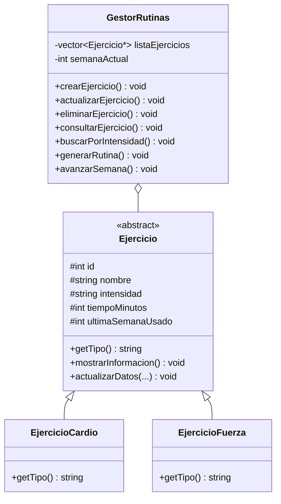

# Routine Planner C++ 
### Sistema de gestión de ejercicios y planificación semanal de rutinas

Proyecto académico desarrollado por **Andrés Olguín y Miguel Margas**, originalmente presentado como **Tarea 1 — Paradigmas de Programación**. Esta implementación de consola permite mantener un catálogo de ejercicios de cardio y fuerza y generar rutinas filtradas por intensidad, utilizando conceptos de programación orientada a objetos en C++.

> **Estado:** ejercicio funcional de consola en evolución técnica. No es una aplicación comercial, un entrenador médico ni un producto de MasterTech SpA. Los siguientes hitos son propuestas, no funcionalidades terminadas.

## Qué permite hacer

| Funcionalidad | Implementación actual |
|---|---|
| Crear ejercicios | ID, nombre, tipo (cardio o fuerza), intensidad, duración y descripción |
| Modificar / eliminar | Gestión por ID dentro del catálogo en memoria |
| Consultar | Búsqueda de un ejercicio específico e impresión de sus propiedades |
| Filtrar | Visualización por intensidad escrita por el usuario |
| Generar rutina | Selección secuencial de ejercicios de la intensidad elegida y suma de minutos |
| Avanzar semana | Incrementa el contador de semana del gestor |

**Detalle técnico:** la selección de rutina intenta evitar ejercicios usados la semana anterior. Se identificó una **limitación en la semana 1**: la condición actual compara `ultimaSemanaUsado = 0` con `semanaActual - 1 = 0`, lo que puede excluir ejercicios recién creados. La corrección está registrada en [la incidencia #2](https://github.com/andres-olguin/routine-planner-cpp/issues/2); todavía requiere una prueba de regresión del menú.

## Inicio rápido

**Requisitos:** compilador de C++17 (GCC, Clang o MSVC compatible). El proyecto no necesita base de datos, bibliotecas de terceros, cuentas ni conexión a Internet.

### Opción A — Compilación directa con GCC/MinGW

```bash
g++ -std=c++17 -Wall -Wextra -pedantic main.cpp SistemaEntrenamiento.cpp -o routine-planner
./routine-planner
```

En Windows con PowerShell y MinGW instalado, compila con el mismo comando y ejecuta `./routine-planner.exe` (o `.\routine-planner.exe`).

### Opción B — CMake y pruebas

Requiere **CMake 3.16 o superior** y un compilador compatible.

```bash
cmake -S . -B build -DCMAKE_BUILD_TYPE=Release
cmake --build build
ctest --test-dir build --output-on-failure
```

El ejecutable de consola queda dentro del directorio `build/` (o `build/Release/` en generadores multiconfiguración). El paso `ctest` ejecuta pruebas de los modelos; **no** prueba todavía todas las opciones del menú interactivo.

## Uso del programa

El menú de consola presenta las siguientes operaciones:

```text
1. Crear un ejercicio
2. Actualizar un ejercicio
3. Eliminar un ejercicio
4. Consultar información de un ejercicio
5. Buscar ejercicios por intensidad
6. Generar una rutina de entrenamiento
7. Avanzar a la siguiente semana
8. Salir
```

**Ejemplo de entrada (ilustrativo):** crear un ejercicio con ID `101`, tipo `1` (cardio), nombre `Caminata`, intensidad `Basico`, 20 minutos y descripción `Actividad aeróbica suave`. La búsqueda por intensidad compara **el texto exactamente**; usa `Basico` y no variantes con tilde o distintas mayúsculas. Para generar rutinas, revisa la limitación de la semana 1 explicada anteriormente.

## Diseño y organización

```text
routine-planner-cpp/
├── main.cpp                       # Menú e interacción por consola
├── SistemaEntrenamiento.h         # Declaraciones de clases y métodos
├── SistemaEntrenamiento.cpp       # Implementación de dominio y gestor
├── CMakeLists.txt                 # Compilación y configuración de pruebas
├── tests/test_models.cpp          # Pruebas de modelos de ejercicios
├── docs/                          # Estudios de evolución y arquitectura
└── informe de tarea 2 paradigmas.pdf  # Entregable académico original
```

**Modelo principal:**



La clase abstracta `Ejercicio` encapsula propiedades comunes; `EjercicioCardio` y `EjercicioFuerza` especializan `getTipo()`; `GestorRutinas` gestiona el catálogo y los avances semanales. La implementación original utiliza punteros y liberación manual de memoria, una oportunidad para modernizarla mediante `std::unique_ptr` y separación entre lógica de dominio e interfaz.

## Estado y limitaciones conocidas

- **Datos solo en memoria:** los ejercicios se pierden al cerrar la aplicación; no existe archivo de guardado ni servicio persistente.
- **Interfaz de consola:** no hay aplicación web, móvil ni interfaz gráfica.
- **Validación insuficiente:** la entrada numérica, duraciones negativas, tipo de ejercicio no reconocido y cadenas vacías no se manejan de forma robusta.
- **Rotación semanal:** la regla de exclusión falla para ejercicios nuevos en la semana 1 y necesita pruebas de regresión.
- **Selección simple:** se recorren ejercicios en el orden ingresado; no hay optimizador, planificación adaptativa, perfiles de usuario ni recomendaciones clínicas.
- **Pruebas:** se incluyen pruebas básicas de modelos, pero falta cubrir el ciclo completo del menú y la generación de rutinas.

## Evolución propuesta

1. **P0 — Corrección y calidad:** solucionar selección en semana 1; validar entradas; añadir pruebas de regresión y gestión segura de memoria.
2. **P1 — Persistencia:** exportar/importar catálogos en formato versionado, validar archivos y recuperar estado.
3. **P2 — Arquitectura:** separar dominio, servicios y CLI; parametrizar políticas de selección y probarlas sin interacción humana.
4. **P3 — Experiencia de usuario:** mejorar accesibilidad del terminal, mensajes de error y ejemplos de uso con capturas propias.
5. **P4 — Evaluación de producto:** identificar una necesidad real antes de considerar una aplicación web o SaaS. No asumir una futura explotación comercial de un trabajo con coautoría.

La evolución detallada se encuentra en [la hoja de ruta de ingeniería](docs/ENGINEERING_ROADMAP_2026-11-04.md) y [el estudio de escalabilidad](docs/ARCHITECTURE_SCALABILITY_2026-11-04.md).

## Calidad y contribuciones

La compilación y las pruebas están configuradas en [GitHub Actions](.github/workflows/cmake.yml). Los cambios de lógica deben incluir pruebas reproducibles y conservar el trabajo académico original. Los resultados de CI no equivalen a una auditoría completa de seguridad ni a una validación del uso del programa.

## Créditos, procedencia y licencia

**Autores del proyecto académico original:** Andrés Olguín y Miguel Margas. El archivo PDF del repositorio corresponde al material histórico de la tarea. Las adiciones de ingeniería y documentación no eliminan ni transfieren derechos de los autores originales.

**Licencia:** no se verificó una licencia de software aplicable a todo el proyecto. Consultar con los autores antes de redistribuir, sublicenciar o comercializar el código.
